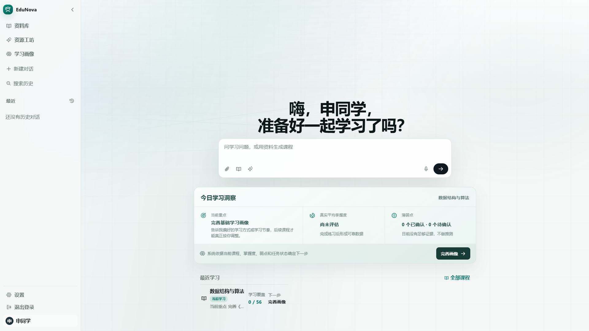

# EduNova

> 面向高校学生的可信、可解释个性化学习系统

EduNova 根据课程资料和学习画像提供问答、资源与学习路径，并用练习诊断和学习报告指导后续复习。

```text
资料解析与建课 → 对话式学习画像 → 课程 RAG 辅导 → 个性化资源与路径
→ 练习诊断与薄弱点 → 再测与下一行动 → 学习报告与课程归档
```



## 核心能力

- **学习画像**：通过对话与学习行为形成 8 维画像，区分全局偏好与课程目标、基础和薄弱点。
- **Agent 协作**：十类 LangGraph 工作流覆盖资料解析、画像、建课、主页与课程辅导、资源、路径、练习、报告和资料对比。
- **资料与问答**：确认多份资料后建课；课程问答优先使用课程证据，展示可核对的来源。
- **学习资源**：生成讲解、思维导图、练习、代码、演示文稿和动画，保留版本，支持调整教法。
- **学习反馈**：结合路径、资源活动、练习、掌握度和弱点推荐下一步，再测结果影响后续安排。
- **交互与隐私**：支持流式问答、语音输入与朗读、图片问答，以及跨会话记忆开关和派生记忆清除。
- **任务恢复**：耗时任务支持进度、恢复、取消和重试；外部服务异常时明确提示或安全降级，不伪造结果。

## 技术栈

| 层次 | 技术 |
| --- | --- |
| 前端 | React、TypeScript、Vite、TanStack Query、Radix UI、ECharts、Mermaid |
| 后端 | FastAPI、SQLAlchemy、Pydantic、Alembic、SSE |
| AI 编排 | LangGraph、LangChain 适配层、OpenAI-compatible 与讯飞等 Provider 适配 |
| 数据与任务 | PostgreSQL + pgvector、Redis、RQ |
| 文档与安全 | Docling、Pyodide 隔离代码验证、MIME 检测、可选 ClamAV |
| 部署 | Docker Compose、Nginx；Windows Electron + NSIS 桌面安装器 |

## 运行方式

- **Docker 源码部署**：使用下方 BAT 入口或[部署指南](docs/DEPLOYMENT.md)中的 Compose 命令。
- **Windows 桌面安装**：从 [Releases](https://github.com/woshimaxfive/EduNova/releases/tag/v0.1.0-desktop-source-preview) 下载 EXE，安装后直接启动，无需 Docker。数据位置与卸载说明见[桌面分发说明](docs/DESKTOP_DISTRIBUTION.md)。

以下环境与启动步骤适用于当前源码的 Docker 部署；安装包对应的源码版本和限制见 Release。

## 运行环境

- Docker Desktop 及 Docker Compose（建议分配不少于 8 GB 内存）
- 可访问 Docker 镜像与 Python/Node 依赖源的网络环境
- AI 对话与生成只需一组主模型凭证；图片能力跟随该模型。默认向量、排序、搜索和语音不需要额外服务 Key。

> 源码包不含真实凭据或个人资料；请勿提交 API Key、账号密码或学习数据。

## 快速启动

### Windows Docker 一键启动

在解压后的项目根目录中，按以下顺序双击：

```text
01_Check_Environment.bat
02_Start_EduNova.bat
```

首次启动从 `.env.example` 创建本机 `.env`，生成随机的 PostgreSQL 密码、JWT 与配置加密密钥，不附带模型凭据。端口默认只绑定本机；就绪后自动打开 `http://127.0.0.1:8080`。

另外提供两个辅助脚本：

```text
03_Stop_EduNova.bat       停止服务并保留本机学习数据
04_Reset_Demo_Data.bat    删除项目数据卷中的全部学习数据，不可恢复
```

**日常停止请用 `03`，不要用 `04`。** 重置不区分演示数据和自己的学习数据，使用前必须备份。

各入口的用途和副作用见[脚本说明](scripts/README.md)。

### 启动后要配置什么

1. 注册账号，选择“空白开始”或内置的“数据结构与算法”课程。
2. 在设置页填写主模型地址和 API Key，获取模型列表或手填模型名，保存后测试连接。自动列表仅支持公网 HTTPS 的 OpenAI 兼容目录；本地服务或无目录的供应商需手填。部署者也可在 `.env` 配置系统主模型。
3. 图片理解复用主模型，测试通过后开放。无需另配识图、向量、重排序、搜索或语音 Key。“管理多套配置”可保存并手动启用备用模型；切换前等待当前回答和后台生成任务结束。

未配置主模型时仍可启动、注册和查看内置课程；AI 问答、路径与资源生成需要有效模型，不提供模拟答案。

| 默认能力 | 准备与限制 |
| --- | --- |
| 本地向量与排序 | 启动脚本准备约 95 MB 向量权重；旧索引不会隐式覆盖，需在设置中按重建流程迁移。见[本地检索](docs/LOCAL_EMBEDDING.md)。 |
| 免 Key 联网搜索 | 本地 SearXNG 仍需访问外部搜索引擎，受网络与上游可用性影响。见[联网搜索](docs/KEYLESS_SEARCH.md)。 |
| 语音输入与朗读 | 启动脚本准备约 238 MB 识别权重；朗读使用浏览器本地中文声音，受设备、权限和声音安装情况影响。见[本地语音](docs/LOCAL_SPEECH.md)。 |

Windows 首次启动无需安装宿主机 Python，需要联网下载镜像、依赖及模型，后续复用已校验权重。升级前备份数据库和 `.env`；启动脚本会清理退役的外部检索、搜索与语音配置，保留主模型。

### 手动安装、升级与自定义端口

按[部署指南](docs/DEPLOYMENT.md)初始化安全配置、准备本地模型并迁移旧配置。保留已有 `.env`，完成模型准备后再启动；修改配置后需重新创建相关容器。

## 推荐演示路径

1. 注册并选择初始课程，或上传两份课程资料。
2. 确认资料目录，使用多份资料创建专题课程并查看资料对比。
3. 通过自然语言完善课程画像。
4. 在课程空间提问，查看流式回答、来源证据与协作轨迹。
5. 生成学习路径和多种资源，完成一次练习。
6. 查看薄弱点、再测、下一行动变化和学习报告。
7. 在设置页查看跨会话记忆与隐私控制；满足阶段条件后可归档并恢复课程。

## 项目结构

```text
backend/          FastAPI 服务、LangGraph 工作流、数据库迁移与后端测试
frontend/         React 前端、组件、路由与前端测试
desktop/          Electron 桌面宿主、权限边界和安装器构建
code-verifier/    Pyodide 隔离代码验证服务
docker/           Dockerfile 与 Nginx 配置
evals/            离线 AI 质量评测
scripts/          启动辅助、检查与测试脚本（见 scripts/README.md）
docs/             公共使用与技术文档（见 docs/README.md）
docker-compose.yml Docker Compose 启动编排
.env.example      不含真实密钥的配置示例
VERSION.txt       源码发布线标识（桌面版本见 desktop/package.json）
THIRD_PARTY_NOTICES.md 主要第三方组件与许可证说明
```

## 文档导航

- 使用与部署：[用户指南](docs/USER_GUIDE.md)、[部署指南](docs/DEPLOYMENT.md)、[脚本说明](scripts/README.md)。
- 技术设计：[系统架构](docs/ARCHITECTURE.md)、[API](docs/API.md)、[数据库](docs/DATABASE_DESIGN.md)、[Agent](docs/AGENT_DESIGN.md)、[RAG](docs/RAG_DESIGN.md)。
- 安全与许可：[隐私说明](docs/PRIVACY.md)、[安全设计](docs/SECURITY.md)、[漏洞报告](SECURITY.md)、[依赖许可证](docs/DEPENDENCY_LICENSES.md)。
- 更多专题与代码入口见[完整文档索引](docs/README.md)。

## 验证命令

```powershell
# 在已安装开发依赖的仓库根目录执行；验证范围见 CONTRIBUTING.md
powershell -NoProfile -ExecutionPolicy Bypass -File scripts/verify_encoding.ps1
powershell -NoProfile -ExecutionPolicy Bypass -File scripts/test.ps1
docker compose config --quiet
```

## 发布源码包说明

源码包应包含运行源码、Docker 配置、依赖清单、`.env.example`、README 与许可证，排除：

```text
.git/、.env、node_modules/、.venv/、dist/、storage/、var/、output/
.planning/、docs/local/、本地研究和开发过程资料
缓存、日志、真实上传资料、导出文件、截图、测试账号数据、API Key
```

保留 `docs/assets/` 的公开产品预览图；排除其他运行截图和测试资料。

从稳定 tag 或已验证的 `main` 提交导出，确保源码包与 GitHub 版本一致。

## 开源与贡献说明

主要第三方组件及许可证见 [THIRD_PARTY_NOTICES.md](THIRD_PARTY_NOTICES.md) 和 [依赖许可证清单](docs/DEPENDENCY_LICENSES.md)。参与开发前请阅读 [贡献指南](CONTRIBUTING.md)；安全问题按 [安全策略](SECURITY.md) 私密报告。

## 许可证

本项目采用 [MIT License](LICENSE)。
